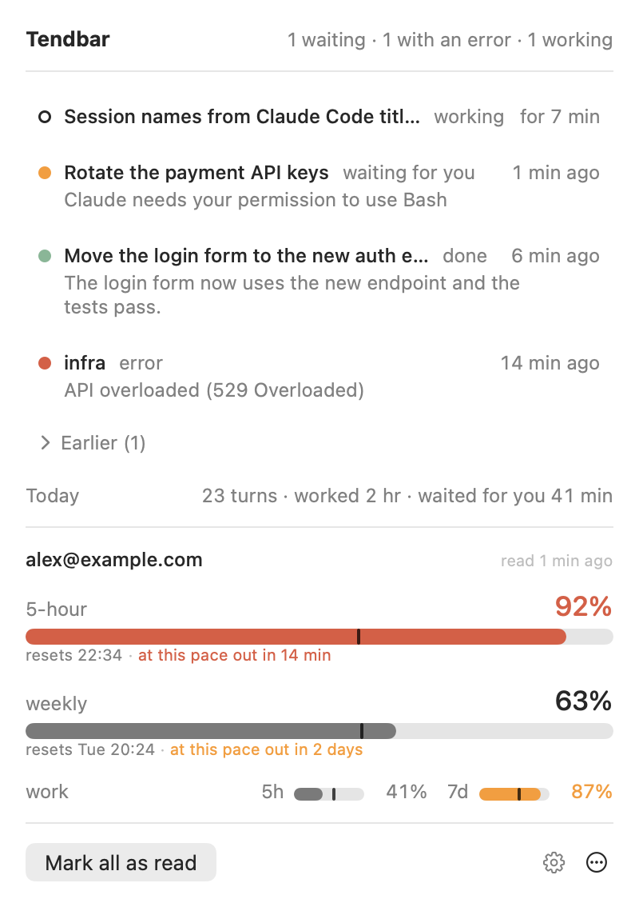
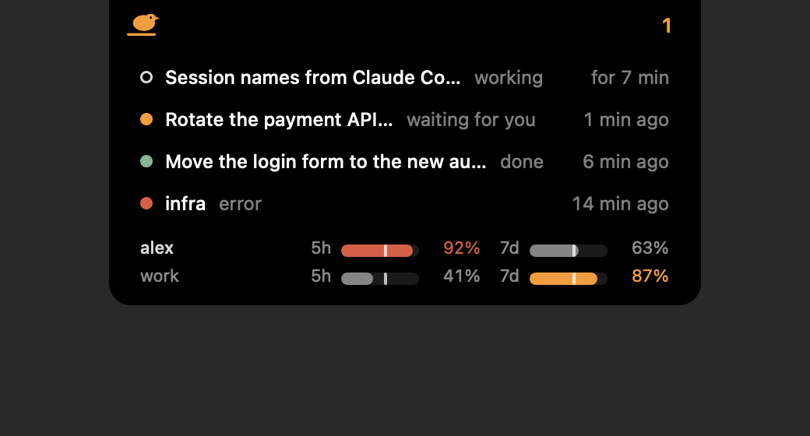
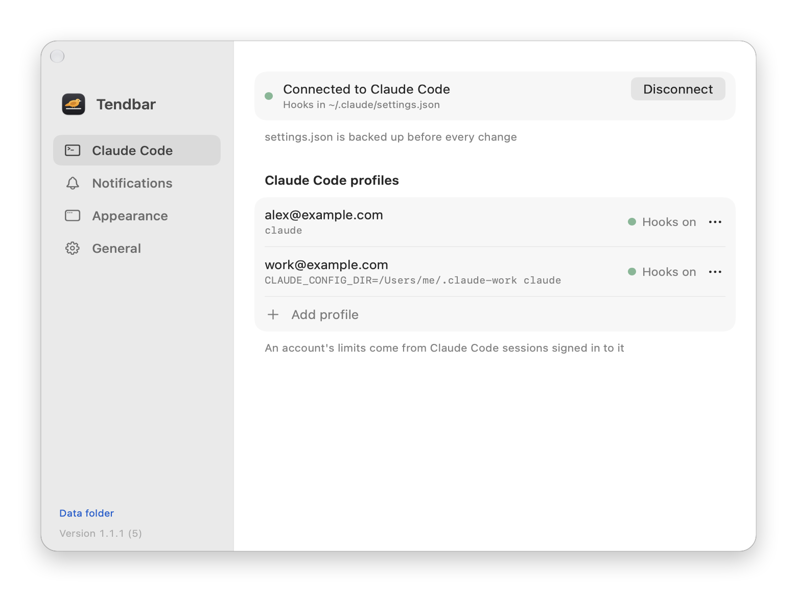

<p align="center">
  
</p>

<h1 align="center">Tendbar</h1>

<p align="center">
  Your Claude Code sessions, one glance away in the menu bar.<br>
  Know when a session is done, waiting for you or failed, jump back to its terminal, and watch your usage limits.
</p>

<p align="center">
  <a href="https://github.com/DabuSoft-pl/tendbar/actions/workflows/test.yml"></a>
  
  
  <a href="LICENSE"></a>
</p>

<p align="center">
  <picture>
    <source media="(prefers-color-scheme: dark)" srcset="docs/images/panel-dark.png">
    
  </picture>
</p>

Run Claude Code in a few terminals and you end up checking tabs to see which one is done and which one is stuck on a
permission prompt. Tendbar tends those sessions for you, so your attention goes where Claude is waiting for it, and
nowhere else.

- **Nothing leaves your Mac.** No account, no network calls, no telemetry.
- **Your login stays yours.** Tendbar never reads OAuth tokens or the Keychain and never calls Anthropic's servers;
  limits come from what Claude Code itself hands its status line.
- **Every account.** Separate `CLAUDE_CONFIG_DIR` profiles side by side, each with its own limits.

## Features

- **Every session in one list.** The name Claude Code gave the conversation (the folder until it has one), state
  and the start of Claude's last reply. A ring while Claude works, amber when it waits for you, vermilion after an
  error, sage green until you read a finished reply. Close a terminal tab and its session ends there too.
- **Back to the right terminal.** Click a session, or pick it with the arrow keys and press Return, to jump to its
  tab or pane (see [Terminals](#terminals)). Or turn on a shortcut in Settings → General (⌃⌥J, for one) that goes
  from any app to the session waiting longest, then to unread replies.
- **Notifications that matter.** A banner when a session needs you, finishes or fails, each one switchable, with
  Tendbar's own short bird calls (or the system sound). Optionally the screen edge glows in the state's color.
  Right-click a session to mute its folder. Sessions in the Claude desktop app keep the app's own notifications
  and permission prompts, with Tendbar adding only the glow and reminders (switchable).
- **Follow-ups.** One reminder when a session has waited for you longer than you set (5 minutes by default), and a
  warning when a working session goes quiet for 15 minutes, since it may hang on a command or a dropped connection.
- **Answer from the notification.** Opt in, and a permission banner shows the whole command or file with Allow and
  Deny. The terminal prompt keeps working, whichever you answer first decides, and your deny rules still apply.
- **A pill by the notch.** The lead state, a count and two thin lines for the five-hour and weekly limits. Hover it,
  or the notch while the pill is hidden, for the sessions and every account's limits; a click on a session closes it
  until the pointer leaves. On Macs without a notch it sits in the middle of the menu bar.
- **Usage limits per account.** Five-hour and weekly usage with a warning at 80% and 90%, for every account you use,
  including separate `CLAUDE_CONFIG_DIR` profiles. A tick on each bar marks the even pace, and when you run ahead of
  it Tendbar tells you when the limit would run out. Resets show as a clock time, and a limit that warned you
  announces when it is available again.
- **Your day in one line.** The panel counts today's turns, Claude's working time and how long it waited for you.
- **Shown your way.** Settings → Appearance picks what sits next to the bird in the menu bar, when the pill shows up,
  and how dense the panel is: with or without reply previews, full or one-line limits.
- **English and Polish.** Follows the macOS language, or pick one in Settings → General.

<p align="center">
  
</p>

## Terminals

| Terminal | Clicking a session |
|---|---|
| Terminal, iTerm2 | Switches to the session's tab |
| WezTerm | Activates the session's pane |
| kitty | Focuses the session's window (needs `allow_remote_control` and `listen_on` in `kitty.conf`) |
| tmux | Selects the pane, then the tab running tmux in Terminal or iTerm2 |
| VS Code, Cursor and other forks | Opens the window of the session's folder |
| Claude desktop app (Code tab, local sessions) | Opens the session in the app |
| Ghostty, Warp, others | Brings the app forward |

## Install

Tendbar is built from source for now (macOS 26+, Xcode 27+, [XcodeGen](https://github.com/yonaskolb/XcodeGen)):

```bash
brew install xcodegen
git clone https://github.com/DabuSoft-pl/tendbar.git
cd tendbar
make install   # Release build into /Applications/Tendbar.app
```

Then open Settings (the gear in the panel, or ⌘,) → Claude Code and press **Connect**. Keep the app in
`/Applications`, since the hooks point at the helper inside it. Settings → General → **Open at login** keeps it
running after a restart.

Builds are signed ad hoc, so they run on the Mac that built them.

<p align="center">
  <picture>
    <source media="(prefers-color-scheme: dark)" srcset="docs/images/settings-dark.png">
    
  </picture>
</p>

## Privacy

- **Nothing leaves your Mac.** Tendbar makes no network calls, has no analytics and never calls Anthropic.
- **No secrets.** It never reads tokens or the Keychain and never switches or rotates accounts.
- **Only what it needs.** The hook helper drops prompts, tool inputs and outputs, file contents and Claude's replies
  before anything reaches the app. The reply preview is read from the local transcript file. The one exception is a
  permission prompt: its tool and command, file path or URL (up to 2,000 characters) reach the app for the Allow and
  Deny banner, stay in memory only and never go to a file or the event log.
- **Not on shared screens.** The pill and the glow stay out of screen sharing and recordings (Settings → General).
- **Your settings, your call.** `~/.claude/settings.json` changes only when you press Connect or Disconnect, never at
  launch. Each change is backed up first (the last five are kept), and Disconnect removes only Tendbar's entries.

Everything Tendbar keeps lives in `~/Library/Application Support/Tendbar` (folder 0700, files 0600):

| File | Contents |
|---|---|
| `sessions.json` | Session id, folder, the conversation's title from its transcript, terminal ids, the Claude Code process id, state, the permission message and the first 200 characters of the last reply |
| `usage.json` | Limit readings per account, keyed by config directory and e-mail address |
| `activity.json` | Per day for the last month: the number of turns and waits, their total time, and the longest wait and turn with their folder name |
| `events.jsonl` | Only when Settings → General → Event log is on (off by default; turning it off deletes it). Hook events for troubleshooting: session id, event, folder, transcript path, message, notification type, the error of a failed turn, and limits when they change. Rotated at 5 MB |

## How it works

Connecting adds Tendbar's hooks to Claude Code. On each hook event Claude Code runs `tendbar-hook`, a small helper
inside the app bundle. It keeps only the fields Tendbar uses, adds the terminal context (`TERM_PROGRAM`, the host
app, iTerm/Terminal session ids, WezTerm, kitty and tmux pane ids and sockets, the TTY, `CLAUDE_CONFIG_DIR`, the
Claude Code process id and its start time, the Claude desktop app's session id), sends the event over a Unix socket
(`~/Library/Application Support/Tendbar/tendbar.sock`, mode 0600) and exits at once. It prints nothing and always
exits 0, so Claude Code is never slowed down or blocked, even when Tendbar is not running.

A permission prompt is the one place the helper waits. It asks the app whether to wait for Allow or Deny from a
banner: with the setting off the app answers at once and the helper exits; with it on, the helper waits (up to 590
seconds, under a 600 second hook timeout) while Claude Code shows its usual prompt. Answering in the terminal goes
ahead as normal, and the helper is released with no output as soon as the session moves on. Only Allow or Deny on
the banner makes it print Claude Code's `PermissionRequest` decision.

A tab closed or a process killed sends no `SessionEnd`, so every 30 seconds the app checks that each session's
Claude Code process still runs, and ends the session when it is gone.

Limits come from the `rate_limits` Claude Code passes to status lines (five-hour and weekly windows on Pro and Max
plans, after the first reply of a session). Connecting wraps your `statusLine`: `tendbar-hook --statusline` sends the
limits to the app, then runs your previous status line command with the same input and prints its output unchanged.
Disconnecting puts the previous command back.

Readings are filed under the account signed in at the time, so switching accounts starts a new entry, and the
previous account keeps its last reading until its window resets.

## Develop

```bash
make test         # Domain, Application and Infrastructure tests
make run          # generate the Xcode project, build and open a Debug build
make install      # Release build into /Applications
make screenshots  # render the README images from sample data
```

The code follows Clean Architecture: a domain package, use cases and adapters, described in [`CLAUDE.md`](CLAUDE.md).
UI strings are English, with the Polish translation in `Tendbar/Localizable.xcstrings`. The app icon is drawn by
`tools/make-icon.swift` and the bird calls are synthesized by `tools/make-sounds.swift`, so the app ships no recorded
or licensed audio.

## Similar projects

Claude Code on the Mac has a lively set of companions, and one of them may suit you better:

- [Vibe Notch](https://github.com/farouqaldori/vibe-notch) puts sessions in a notch island with approve and deny
  controls.
- [Nudge](https://github.com/ZachDeLong/nudge) and [Checkpoint](https://github.com/DouweBos/Checkpoint) focus on
  answering permission prompts from the menu bar.
- [Clabar](https://github.com/Magir/clabar), [claude-code-usage](https://github.com/pedroprates/claude-code-usage)
  and [CodexBar](https://github.com/steipete/CodexBar) show usage limits, CodexBar for several providers.
- [Claude Code Menu](https://github.com/PiXeL16/claudecode-macmenu) adds usage analytics and notifications.

Tendbar's take is attention rather than usage: which session waits for you, for how long, and the shortest way back
to its terminal, with limits read from Claude Code itself and nothing sent anywhere.

## Contributing

Bugs and ideas are welcome in [issues](https://github.com/DabuSoft-pl/tendbar/issues); Settings → General → Diagnostics
copies what a bug report needs without anything private. See [CONTRIBUTING.md](CONTRIBUTING.md), and report security
problems privately as described in [SECURITY.md](SECURITY.md).

## License

[MIT](LICENSE). Tendbar is an independent project, not affiliated with or endorsed by Anthropic.
