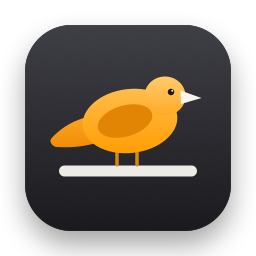

<p align="center">
  
</p>

<h1 align="center">Tendbar</h1>

<p align="center">
  Your Claude Code sessions, one glance away in the menu bar.<br>
  See which session is done, waiting for you or failed, jump back to its terminal, and watch your usage limits.
</p>

<p align="center">
  <a href="https://github.com/DabuSoft-pl/tendbar/actions/workflows/test.yml"></a>
  
  
  <a href="LICENSE"></a>
</p>

<p align="center">
  <a href="https://alternativeto.net/software/tendbar/about/?utm_source=badge&utm_medium=referral"></a>
</p>

<p align="center">
  <picture>
    <source media="(prefers-color-scheme: dark)" srcset="docs/images/panel-dark.png">
    
  </picture>
</p>

## Features

- **All sessions in one list** with their state and the start of Claude's last reply.
- **Jump back** to a session's terminal tab or pane with a click, the arrow keys, or a global shortcut.
- **Notifications** when a session needs you, finishes or fails, with optional screen-edge glow and bird calls.
  Quiet during a Focus.
- **Follow-ups:** a reminder when a session waits too long, a warning when a working one goes silent.
- **Allow or Deny** permission prompts from the panel, the notch pill or the banner (opt in). A request Tendbar
  can't show in full (over 2,000 characters, a file's new content, MCP tool arguments) gets Deny only.
- **A pill by the notch** with the lead state and both limits; hover it for the details.
- **Usage limits** (five-hour and weekly, Pro and Max plans) for every `CLAUDE_CONFIG_DIR` profile, with warnings
  at 80% and 90%. The Claude desktop app runs no status line, so its sessions don't update limits.
- **Daily stats:** turns, working time and waiting time, plus the last seven days.
- English and Polish.

<p align="center">
  
</p>

## Install

```bash
brew tap dabusoft-pl/tap
brew trust dabusoft-pl/tap
brew install --cask tendbar
```

Or download the DMG from the [latest release](https://github.com/DabuSoft-pl/tendbar/releases/latest) (macOS 26+,
signed and notarized, updates itself through Sparkle).

Then open Settings (⌘,) → Claude Code → **Connect**. Keep the app in `/Applications`: the hooks point at the helper
inside it.

## Terminals

| Terminal | Clicking a session |
|---|---|
| Terminal, iTerm2 | Switches to the tab |
| WezTerm | Activates the pane |
| kitty | Focuses the window (needs `allow_remote_control` and `listen_on`) |
| tmux | Selects the pane, then the tab in Terminal or iTerm2 |
| VS Code, Cursor and forks | Opens the folder's window |
| Claude desktop app | Opens the session |
| Ghostty, Warp, others | Brings the app forward |

## Privacy

- **Nothing leaves your Mac.** No analytics, no calls to Anthropic. The only network use is the daily update check
  on GitHub, which you can turn off.
- **No secrets.** Never reads OAuth tokens or the Keychain, never switches accounts. Limits come from what Claude
  Code passes to its status line.
- **Minimal data.** The hook helper drops prompts, tool inputs and outputs and Claude's replies before anything
  reaches the app. The reply preview (first 200 characters) is read from the local transcript. Permission prompt
  details stay in memory only.
- **Your settings, your call.** `settings.json` changes only on Connect or Disconnect, never at launch, with a
  backup first.
  Disconnect removes only Tendbar's entries.

Data lives in `~/Library/Application Support/Tendbar` (folder 0700, files 0600).

## How it works

Connecting adds Tendbar's hooks to Claude Code. Each hook runs `tendbar-hook`, a helper inside the app that strips
the event down, adds terminal context and sends it over a Unix socket. It prints nothing and exits at once, so
Claude Code is never slowed down, even when Tendbar is not running. The one exception is a permission prompt with
Allow/Deny turned on: the helper then waits for your answer while the terminal prompt keeps working.

Limits come from the `rate_limits` Claude Code passes to status lines: Tendbar wraps your `statusLine`, runs your
original command unchanged, and restores it on Disconnect.

## Develop

Needs Xcode 27+ and [XcodeGen](https://github.com/yonaskolb/XcodeGen).

```bash
make test      # tests
make run       # Debug build
make install   # Release build into /Applications
```

The architecture is described in [`CLAUDE.md`](CLAUDE.md).

## Similar projects

[Vibe Notch](https://github.com/farouqaldori/vibe-notch), [Nudge](https://github.com/ZachDeLong/nudge),
[Checkpoint](https://github.com/DouweBos/Checkpoint), [Clabar](https://github.com/Magir/clabar),
[CodexBar](https://github.com/steipete/CodexBar), [Claude Code Menu](https://github.com/PiXeL16/claudecode-macmenu).
Tendbar focuses on attention rather than usage: which session waits for you, and the fastest way back to it.

## Contributing

Bugs and ideas go to [issues](https://github.com/DabuSoft-pl/tendbar/issues) (Settings → General → Diagnostics
copies what a report needs). See [CONTRIBUTING.md](CONTRIBUTING.md) and [SECURITY.md](SECURITY.md).

## License

[MIT](LICENSE). Not affiliated with or endorsed by Anthropic.
